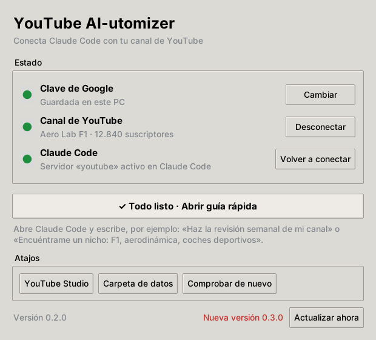

# YouTube AI-utomizer

Conecta **Claude Code** con **tu canal de YouTube** desde tu PC. Claude puede ver tus
estadísticas e ingresos, buscar nichos, preparar y subir vídeos (en privado) y publicarlos
cuando tú lo apruebes, respetando las normas de YouTube sobre IA.



## Instalación en PC (Windows)

1. Ve a **[Releases](https://github.com/davCreate/Youtube-AI_utomizer/releases/latest)** y descarga
   `YouTube-AI-utomizer-windows.zip`. No necesitas instalar Python.
2. Descomprímelo en una carpeta fija, por ejemplo `Documentos\YouTube-AI-utomizer`. No la muevas después.
3. Doble clic en **`YouTube-AI-utomizer.exe`**.
   - Si Windows avisa con «Windows protegió su PC»: pulsa *Más información → Ejecutar de todas formas*.
     Sale porque la app no está firmada con un certificado de pago.
4. Pulsa **«Configurar todo»**. La app te guía en 3 partes:
   1. **Clave de Google** (5 pasos, unos 5 minutos): cada paso abre la página de Google y te dice qué
      botón pulsar. La clave descargada se detecta sola en Descargas.
   2. **Canal de YouTube**: eliges tu cuenta. Si Google avisa de «app no verificada», es normal:
      es tu propia app. Pulsa *Configuración avanzada → Ir a yt-automizer*.
   3. **Claude Code**: se conecta solo.
5. Cuando los tres puntos estén en verde, abre Claude Code y escribe: *«Haz la revisión semanal de mi canal»*.

### La app

- **Estado**: un punto verde o rojo para la clave, el canal y Claude Code, cada uno con su botón para arreglarlo.
- **Buscar actualizaciones**: mira la última versión en Releases. Si hay una nueva, te enseña las
  novedades y se actualiza con un clic (cierra Claude Code antes). También lo comprueba sola al abrirse.
- **Atajos**: YouTube Studio, carpeta de datos y volver a comprobar el estado.

### Sin el .exe (desde el código)
Doble clic en `instalar.bat` (Windows) o `bash instalar.sh` (macOS/Linux). Necesita Python 3.10 o
superior, instala todo y abre la misma app. El botón de actualizar también funciona en este modo.

### Si algo falla
- Abre la app y pulsa «Comprobar de nuevo». Cada punto rojo tiene su botón para arreglarlo.
- Desde una terminal: `yt-automizer-server.exe doctor`.
- Si la sesión de Google caduca, Claude Code abre el navegador solo para que vuelvas a entrar.

## Qué puede hacer Claude

| Área | Herramientas |
|---|---|
| Estadísticas | `channel_overview`, `list_recent_videos`, `performance_summary` (visitas, tiempo de visualización, retención, Shorts frente a largos, fuentes de tráfico), `analytics_query` (cualquier consulta de YouTube Analytics) |
| Dinero | `revenue_report`: ingresos estimados, CPM, RPM, día a día. Solo con el canal en YPP. |
| Investigación | `search_youtube`, `research_niches`: puntuación de 0 a 100 según demanda y canales pequeños que triunfan, con vídeos de ejemplo |
| Publicar | `compliance_check`, `upload_video` (siempre **privado**), `publish_video` (necesita tu aprobación; también puede programar), `update_video_metadata` |
| Comunidad | `list_comments`, `reply_to_comment` |
| Seguridad | `quota_status`, `audit_log` (todo lo que se cambia, con los valores antiguos para deshacer) |
| Atajos | `weekly_review`, `find_niche` |

Opcional: copia `docs/claude-settings.example.json` a `.claude/settings.json` (o a
`~/.claude/settings.json`). Así las consultas de solo lectura van sin preguntas, y subir,
publicar, editar o responder siempre te pide confirmación.

## Normas de YouTube integradas (`src/yt_automizer/compliance.py`)
- **Contenido alterado o sintético:** cada subida declara `containsSyntheticMedia`, el campo de la
  API desde octubre de 2024. Avisa si usas herramientas como clonación de voz o vídeo con IA y no lo declaras.
- **Contenido "inauthentic" (YPP):** bloquea si no describes tu aportación humana, si el vídeo es
  casi igual a uno reciente, o si se superan 3 subidas en 24 horas.
- **Temas delicados** (salud, finanzas, noticias, elecciones) con IA: pide contrastar datos y citar fuentes.
- **COPPA:** hay que indicar siempre si el vídeo es para niños.
- **Límites de la API:** título hasta 100 caracteres, descripción hasta 5000 bytes, etiquetas hasta 500, Shorts hasta 3 minutos.

Los umbrales se cambian en `~/.yt-automizer/settings.json`. Ahí se guardan también la sesión,
el registro y la cuota, siempre en tu PC.

## A tener en cuenta
- YouTube puede dejar en privado los vídeos subidos por la API desde un proyecto sin auditar.
  Pide la [auditoría de la API](https://support.google.com/youtube/contact/yt_api_form) pronto;
  mientras tanto, sube con la herramienta y publica desde YouTube Studio.
- Cuota de 10.000 unidades al día: investigar una palabra clave gasta unas 100 y subir un vídeo unas 1.600.

## Desarrollo
```bash
python -m venv .venv && .venv/bin/pip install -e '.[dev]' && .venv/bin/pytest -q
.venv/bin/pip install -e '.[build]' && .venv/bin/python packaging/build.py   # genera los ejecutables
```

### Publicar una versión nueva
1. Sube el número en `src/yt_automizer/__init__.py` y `pyproject.toml` (por ejemplo, `0.3.0`).
2. `git tag v0.3.0 && git push origin v0.3.0`
3. GitHub Actions (`.github/workflows/release.yml`) pasa los tests, compila el `.exe` en Windows,
   comprueba que el servidor responde y publica la Release con el zip. A partir de ahí,
   «Buscar actualizaciones» la encuentra en todos los PCs.
